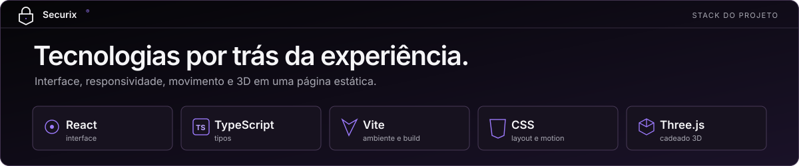

<div align="center">

# Securix®

**Uma landing page conceitual sobre proteção de operações digitais complexas.**



<br>

[Visão geral](#visão-geral) · [Experiência](#experiência) · [Tecnologias](#tecnologias) · [Execução](#executar-localmente) · [Documentação](#documentação)

</div>

---

## Visão geral

A **Securix® é uma empresa fictícia** criada para este projeto de portfólio front-end. O site apresenta como uma organização de cibersegurança poderia explicar sua abordagem de proteção de forma clara e visual, sem inventar clientes, certificações ou resultados.

A página foi pensada como uma história contínua: cada seção introduz uma ideia, e a próxima aprofunda o assunto. O visitante percorre seis capítulos por rolagem, sem precisar aprender controles especiais para entender o conteúdo. O visual usa fundo escuro, superfícies grafite e detalhes violeta para manter o foco na leitura e nas interações.

## Experiência

| Capítulo | O que você encontra |
| :--- | :--- |
| **Fundação** | A apresentação da Securix® e o cadeado 3D que representa a identidade do projeto. |
| **Arquitetura** | Três camadas selecionáveis — engenharia, inteligência e resiliência — para explorar a abordagem proposta. |
| **Especialidades** | Quatro frentes de atuação em sequência vertical, com textos e símbolos próprios. |
| **Setores** | Composições visuais que mostram diferentes contextos de aplicação. |
| **Confiança** | Os princípios que organizam a mensagem da marca fictícia. |
| **Convite** | O encerramento da narrativa e o caminho para o perfil do autor. |

### Cadeado interativo

O cadeado pode ser girado na horizontal e na vertical: clique e arraste com o mouse, ou selecione o objeto e use as setas do teclado. Ele também tem um movimento ambiente discreto. Em dispositivos de toque, a área preserva a rolagem vertical e o gesto de pinça. Quando o navegador não oferece WebGL ou a pessoa prefere movimento reduzido, o site mostra uma versão em CSS.

### Rolagem e movimento

Textos e imagens aparecem suavemente conforme entram na tela. O título de Especialidades acompanha o fluxo natural da página, enquanto os quatro itens passam em sequência. Em telas maiores, o cabeçalho se recolhe ao rolar para baixo e retorna ao subir; no mobile, os atalhos são ocultados para deixar mais espaço ao conteúdo. As informações continuam acessíveis sem animação.

## Tecnologias

| Tecnologia | Responsabilidade no projeto |
| :--- | :--- |
| **React** | Organiza os capítulos e os componentes da interface. |
| **TypeScript** | Define os tipos do conteúdo e das interações. |
| **Vite** | Executa o ambiente local e gera o build estático. |
| **CSS nativo** | Controla layout, responsividade, estados e transições visuais. |
| **Three.js + React Three Fiber** | Desenha e anima o cadeado 3D no navegador. |

O conteúdo fica em `src/content/site.ts`; cada capítulo tem seu componente em `src/sections/`. O código do cadeado 3D é carregado separadamente, quando o navegador fica ocioso, para priorizar o texto inicial da página.

## Executar localmente

Você precisa de Node.js compatível com a versão do Vite instalada e de npm. Na pasta do projeto:

```bash
npm install
npm run dev
```

Abra no navegador o endereço exibido pelo Vite. Para gerar e visualizar os arquivos estáticos de produção:

```bash
npm run build
npm run preview
```

O build é criado em `dist/`. O projeto ainda não foi publicado.

## Verificar a implementação

```bash
npm run typecheck
npm run lint
npm run build
npm run test:smoke
```

O smoke test verifica os seis capítulos, a navegação, o cadeado, a rolagem e a ausência de overflow horizontal em quatro larguras de tela. Ele usa o Chrome instalado localmente e espera o servidor Vite em `http://127.0.0.1:5173/`. Para testar outro endereço, use `npm run test:smoke -- <URL>`.

## Escopo e limites

Este é um projeto **somente de front-end**. Não há backend, autenticação, formulário de contato ou coleta de dados. O cadeado é um modelo procedural; seu módulo 3D acrescenta aproximadamente 244 kB comprimidos quando carregado. Medições Lighthouse, validação em dispositivos físicos, outros navegadores e publicação estão registradas no [roadmap](docs/ROADMAP.md).

## Documentação

| Documento | Para que serve |
| :--- | :--- |
| [Visão do produto](PRODUCT.md) e [brief](docs/PROJECT_BRIEF.md) | Explicam público, proposta e limites. |
| [Requisitos](docs/REQUIREMENTS.md) | Registram comportamentos e critérios de aceitação. |
| [Design](DESIGN.md) e [guia visual](docs/DESIGN_SYSTEM.md) | Descrevem tokens, tipografia e identidade visual. |
| [Arquitetura](docs/ARCHITECTURE.md) e [decisões](docs/DECISIONS.md) | Mostram a organização do código e as escolhas técnicas. |
| [Roadmap](docs/ROADMAP.md) | Separa o que foi concluído do que ainda precisa ser verificado. |

---

Projeto conceitual de front-end · [GitHub de RaiBrs](https://github.com/RaiBrs)
