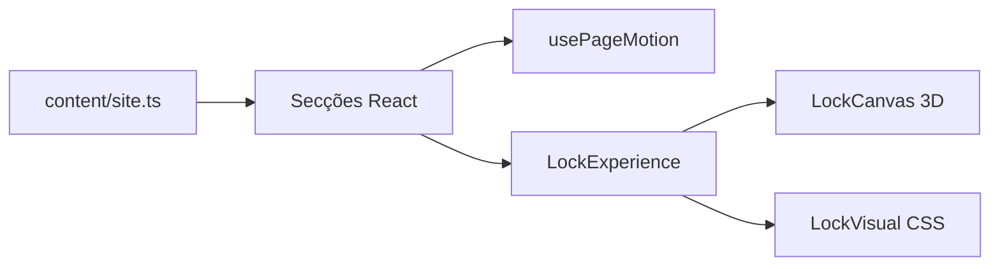

# Arquitetura

> **Estrutura:** conteúdo em dados, seis secções React, estilos CSS nativos e um módulo 3D carregado separadamente.

[← README](../README.md) · [Requisitos](REQUIREMENTS.md) · [Decisões](DECISIONS.md)

---



## Estrutura atual

```text
src/
  components/LockVisual.tsx
  components/LockExperience.tsx
  components/ExpertiseSymbol.tsx
  content/site.ts
  hooks/usePageMotion.ts
  sections/Hero.tsx
  sections/Architecture.tsx
  sections/Expertise.tsx
  sections/Industries.tsx
  sections/Confidence.tsx
  sections/Invitation.tsx
  three/LockCanvas.tsx
  styles/tokens.css
  styles/chapters.css
  styles/expertise.css
  App.tsx
  App.css
  index.css
  main.tsx
```

`App` compõe as seis secções, o Header e o Footer. `content/site.ts` guarda a navegação e os textos. `usePageMotion` observa entradas e atualiza o progresso da página. `Expertise` apresenta quatro artigos no fluxo vertical, com símbolos SVG decorativos em `ExpertiseSymbol`. `LockExperience` escolhe entre `LockCanvas`, carregado sob demanda, e `LockVisual`, alternativa em CSS. Os estilos globais e de secção mantêm a composição separada da lógica.

A aplicação é estática e não possui contratos HTTP ou estado de dados. `LockExperience` prepara o módulo 3D quando o navegador fica ocioso, captura o ponteiro durante o arrasto e passa os ângulos ao modelo sem atualizar o estado React a cada movimento. A renderização pausa quando está fora do ecrã. A área do cadeado permite a rolagem vertical e a pinça em dispositivos táteis.

---

**Continue em:** [Decisões técnicas →](DECISIONS.md)
